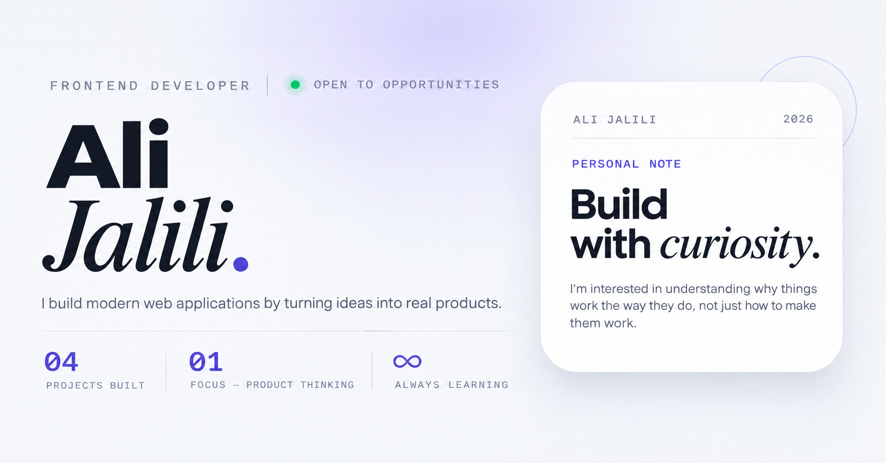

<div align="center">

  

  <p><sub>FRONTEND DEVELOPMENT&nbsp;&nbsp;·&nbsp;&nbsp;PRODUCT THINKING&nbsp;&nbsp;·&nbsp;&nbsp;THE WEB, BUILT WITH CARE</sub></p>

  <p><sub>Building thoughtful, useful web experiences from idea to interface.</sub></p>

  <a href="https://ali-jalili.vercel.app/"><strong>Open the live portfolio ↗</strong></a>
  &nbsp;·&nbsp;
  <a href="#featured-work">Explore selected work</a>

</div>

---

## About

I'm **Ali Jalili** — a frontend developer who enjoys understanding how products work, why certain decisions are made, and how different parts come together to solve a problem.

To me, building software goes beyond turning designs into working interfaces. It means understanding the purpose behind each feature, considering how it should behave, and making technical decisions that keep the product reliable and maintainable.

I'm curious about the reasoning behind things, not just how to implement them. I enjoy exploring different approaches, understanding their trade-offs, and finding ways to make the solutions I build better.

## Currently

I'm developing my skills in modern frontend development, exploring application architecture, and taking on more complex engineering challenges.

| Building                | Exploring                | Goal                    |
| ----------------------- | ------------------------ | ----------------------- |
| Real-world applications | Application architecture | 🟢 Open to opportunities |

## Featured work

| Project       | What it does                                                                                                                   | Links                                                                                                                  |
| ------------- | ------------------------------------------------------------------------------------------------------------------------------ | ---------------------------------------------------------------------------------------------------------------------- |
| **FailStack** | Incident postmortem platform — structured timelines, root-cause trees, review & publication workflows with row-level security. | [Live demo ↗](https://failstack.vercel.app/) · [Source](https://github.com/Ali-jalili/FailStack)                       |
| **DevDesk**   | Browser-based API workspace — organize endpoint documentation, environment-aware requests, and inspect live responses.         | [Live demo ↗](https://devdesk-omega.vercel.app/) · [Source](https://github.com/Ali-jalili/DevDesk)                     |
| **FormFlow**  | Visual form builder — build, publish, and manage forms with a response inbox.                                                  | [Live demo ↗](https://form-flow-fawn.vercel.app/) · [Source](https://github.com/Ali-jalili/FormFlow)                   |
| **NexusOS**   | Role-based project workflows connecting agency clients, admins, and developers.                                                | [Live demo ↗](https://nexus-os-dashboard-seven.vercel.app/) · [Source](https://github.com/Ali-jalili/NexusOS-Platform) |

## How I work

I start with understanding the problem, choose a suitable solution, and consider the impact of each decision.

**01 Explore** — requirements, user flow, and technical needs before writing code.
**02 Build** — reusable components, clear responsibilities, a maintainable structure.
**03 Improve** — review decisions, cut unnecessary complexity, refine the result.

## Built with

<p>
  
  
  
  
  
  
</p>

Typed, component-based UI with **React + TypeScript**, fast builds with **Vite**, design tokens and responsive styling with **Tailwind CSS v4**, interface motion with **Framer Motion**, and lightweight icons with **Lucide**.

## Run locally

You'll need Node.js and pnpm.

```bash
git clone https://github.com/Ali-jalili/Personal-Portfolio.git
cd Personal-Portfolio
pnpm install
pnpm dev
```

The development server starts at `http://127.0.0.1:5182`.

<details>
<summary><strong>Available commands</strong></summary>

| Command        | Description                                          |
| -------------- | ---------------------------------------------------- |
| `pnpm dev`     | Start the local development server.                  |
| `pnpm build`   | Type-check and create a production build in `dist/`. |
| `pnpm preview` | Preview the production build locally.                |
| `pnpm lint`    | Run ESLint across the project.                       |

</details>

<details>
<summary><strong>Project structure</strong></summary>

```text
src/
├── components/   # Shared UI and lazy-loaded page sections
├── data/         # Project content
├── features/     # Hero, about, skills, projects, and other sections
├── hooks/        # Reusable React hooks
├── layouts/      # Page layout and navigation
└── types/        # Shared TypeScript types
public/           # Static assets, social preview, and resume
```

</details>

---

<div align="center">

  **Have a product, problem, or idea in mind?**<br />
  <sub>I'm open to opportunities where I can contribute my skills, learn through collaboration, and grow.</sub><br /><br />

  <a href="mailto:ali.jalili.dev@gmail.com"><strong>Start a conversation →</strong></a>

  <p><sub>Also find me on <a href="https://www.linkedin.com/in/ali--jalili">LinkedIn</a> · <a href="https://github.com/Ali-jalili">GitHub</a></sub></p>

  <p><sub>Designed and built by Ali Jalili · React · TypeScript</sub></p>

</div>
